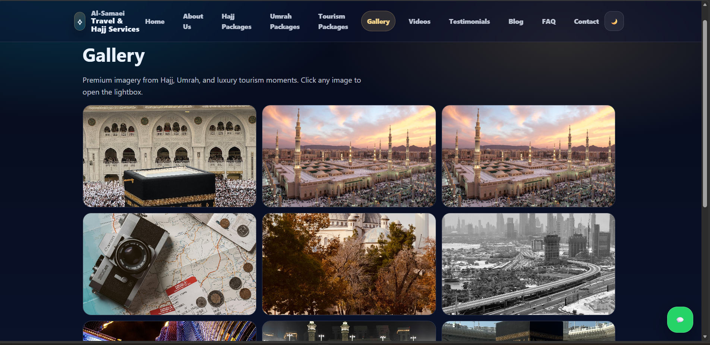
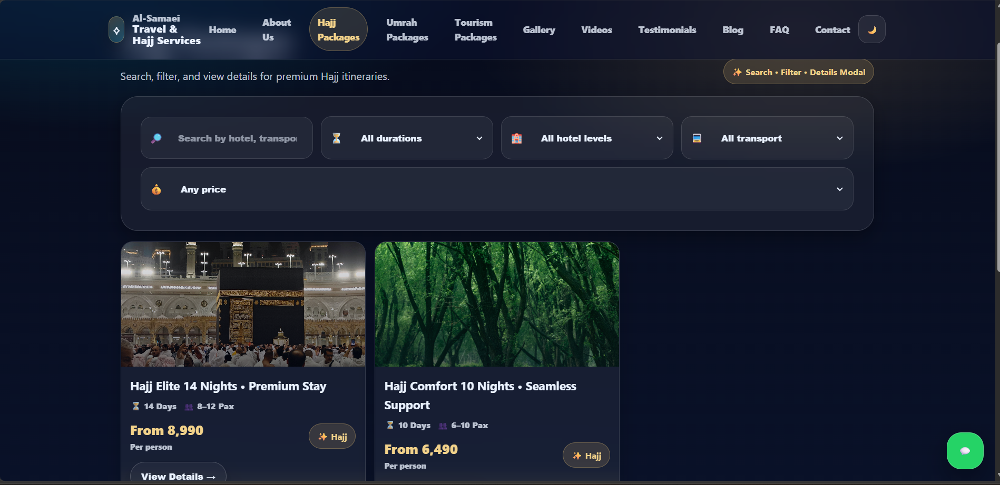

# Yemen Travel & Hajj Services | Front-End Website

> A multi-page travel website concept for Hajj, Umrah, and tourism, built with HTML, CSS, and JavaScript.

**Stack:** HTML5 · CSS3 · JavaScript · Responsive Web Design

## Preview

## Pages
| Section | File |
| --- | --- |
| Home | [index.html](index.html) |
| About | [about.html](about.html) |
| Hajj | [hajj.html](hajj.html) |
| Umrah | [umrah.html](umrah.html) |
| Tourism | [tourism.html](tourism.html) |
| Gallery | [gallery.html](gallery.html) |
| FAQ | [faq.html](faq.html) |
| Contact | [contact.html](contact.html) |

## More screenshots

| Gallery | Hajj |
| --- | --- |
|  |  |

## Features described
Multi-page navigation · Photo and video galleries · Testimonials · FAQ · Dark/light theme · Mobile-friendly layouts

## Run locally
Download the repository and open `index.html` in a browser. Some features may depend on browser settings and available assets.

## Scope
This is a front-end portfolio project. No live booking, payment processing, or commercial travel operations are claimed.

## Author
[abdullahdataai](https://github.com/abdullahdataai)